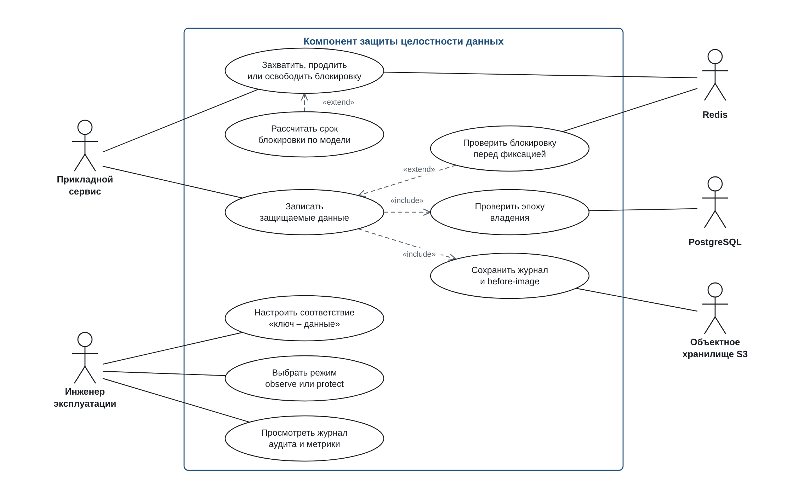
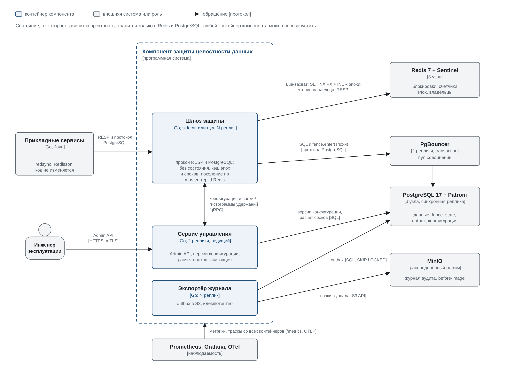
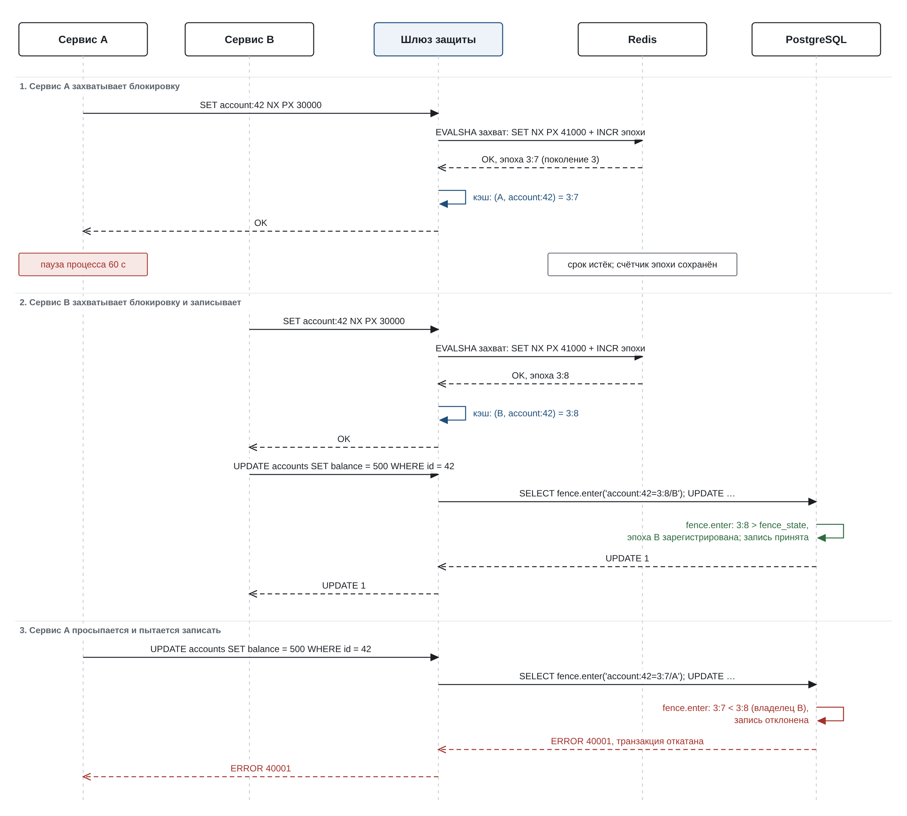
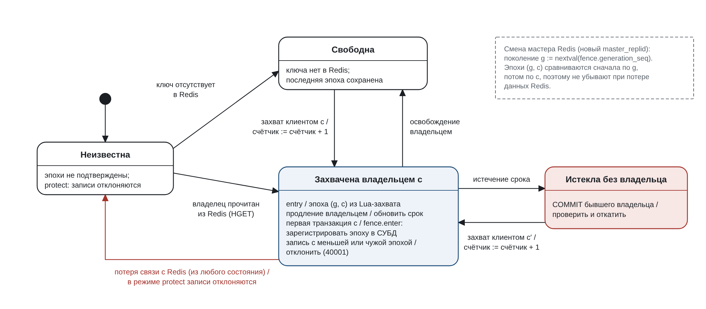
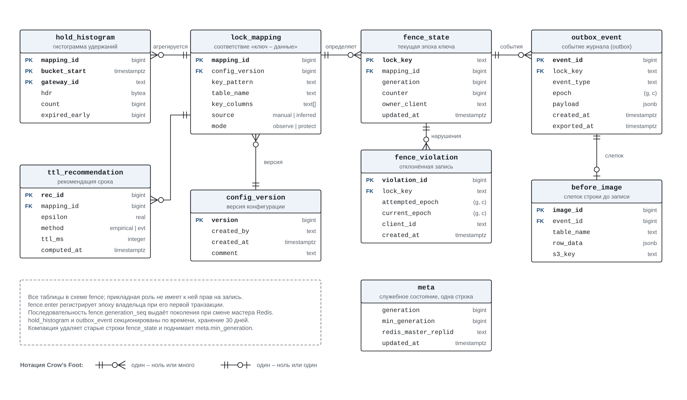
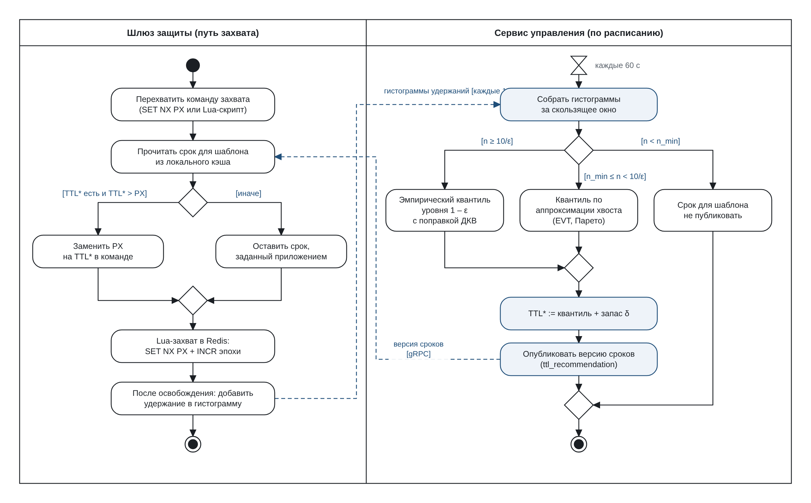
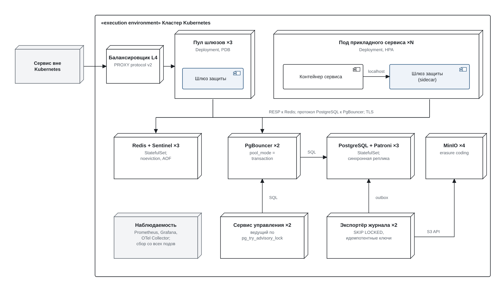
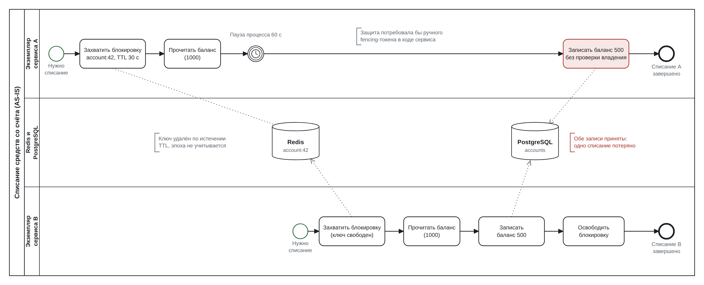
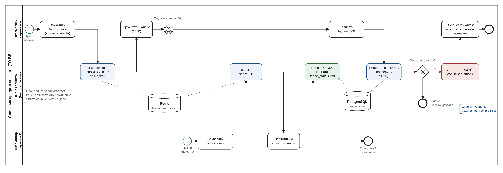

# ЛР 3 – проектирование

**Тема ВКР:** Разработка прототипа компонента защиты целостности данных при распределённых блокировках средствами PostgreSQL и адаптивной модели таймаутов

**Автор или участники команды:** Черняховский Илья Сергеевич, группа К3423 (научный руководитель – Иванов С. Е.)

**Вклад каждого участника при командной работе:** работа выполняется индивидуально.

**Материалы:** отчёт – этот файл; диаграммы – [`assets/`](../../assets/) (PNG для отчёта, рядом SVG-исходники с тем же именем).

## 1. Предметная область и требования

### Описание предметной области

Бэкенд-сервисы, которые работают в нескольких экземплярах, используют распределённые блокировки для эксклюзивного доступа к общему ресурсу: списание с баланса, бронирование места, резервирование товара. Типовая реализация – ключ в Redis с ограниченным сроком (lease): `SET key value NX PX ttl` или Lua-скрипты библиотек redsync (Go) и Redisson (Java). Срок нужен, чтобы упавший владелец не держал ресурс вечно, но он же создаёт уязвимость. Если процесс-владелец приостановлен дольше срока (пауза сборщика мусора, планировщик ОС, сеть), блокировка истекает, её захватывает другой экземпляр, а проснувшийся первый процесс продолжает критическую секцию и записывает данные, считая себя владельцем. Результат – потерянное обновление или двойное списание, которое прикладной код не замечает.

Известная защита – fencing-токен: сервис блокировок выдаёт монотонно растущий номер, хранилище отклоняет запись с номером меньше уже виденного. Она требует изменения кода каждого сервиса и хранилища, поэтому в существующих системах применяется редко. Подбор срока блокировки обычно эвристический (фиксированный множитель к среднему времени операции) и не учитывает хвост распределения пауз.

Проектируемая система – компонент, который ставится между сервисами и хранилищами (Redis и PostgreSQL) как прозрачный шлюз. Шлюз переписывает захват блокировки в атомарный Lua-скрипт, который вместе с ключом увеличивает счётчик эпохи владения, регистрирует эпоху в PostgreSQL при первой транзакции нового владельца, а функция проверки и триггер в СУБД отклоняют запись клиента, утратившего блокировку. Дополнительно компонент собирает телеметрию удержаний и пауз и рассчитывает срок блокировки по вероятностной модели так, чтобы вероятность преждевременного истечения не превышала заданный порог ε.

Компонент проектируется для промышленной эксплуатации, а не только для стенда: он стоит в пути каждой записи, поэтому сам не должен становиться единой точкой отказа или узким местом. Отсюда четыре архитектурных принципа, полученных по итогам аудита первой версии модели:

1. **Шлюз без состояния.** Всё, от чего зависит корректность, хранится в Redis и PostgreSQL; реплики шлюза взаимозаменяемы и масштабируются горизонтально.
2. **Эпоха назначается атомарно с захватом** – в одном Lua-скрипте в Redis, а не отдельным шагом в памяти шлюза.
3. **Эпоха двухуровневая: (поколение, счётчик).** Поколение выдаёт последовательность PostgreSQL при каждой смене мастера Redis, поэтому эпохи не убывают, даже если при переключении Redis потерял последние записи.
4. **Плоскость данных отделена от плоскости управления.** Настройка, расчёт сроков и выгрузка журнала вынесены в отдельные сервисы; их отказ не останавливает трафик.

**Пользователи и роли:**

- **Прикладной сервис** (экземпляры сервисов на redsync и Redisson) – работает с компонентом, не зная о нём: меняется только адрес подключения.
- **Инженер эксплуатации** – настраивает соответствие «ключ блокировки – защищаемые данные», выбирает режим работы, просматривает журнал аудита и метрики.
- **Внешние системы** – Redis 7 с Sentinel (блокировки и счётчики эпох), PostgreSQL 17 с Patroni (данные, триггер проверки, служебная схема), PgBouncer (пул соединений), S3-совместимое хранилище MinIO (журнал и слепки), Prometheus, Grafana и OpenTelemetry (наблюдаемость).

**Поддерживаемые процессы:** захват, продление и освобождение блокировки с назначением эпохи; запись в защищаемые таблицы с проверкой эпохи; проверка блокировки перед фиксацией транзакции; расчёт срока блокировки; ведение журнала аудита и слепков строк; настройка и наблюдение.

**Условия применимости.** Строгая гарантия (эквивалентность ручному fencing-токену) действует, если клиент однозначно идентифицируется (шлюз развёрнут sidecar-контейнером в поде сервиса или получает адрес клиента по PROXY protocol), служебные ключи Redis не вытесняются (`noeviction`), а соответствие «ключ – данные» задано или выведено верно. Повторный захват той же блокировки другим потоком того же экземпляра при общем пуле соединений по трафику неотличим – это граница метода, она проверяется отдельно.

**Что именно гарантируется.** Эпоха владельца регистрируется в `fence_state` при его первой транзакции, а не при первой записи. Поэтому, как только новый владелец впервые обратился к данным (в том числе на чтение), любая запись бывшего владельца отклоняется. Запись бывшего владельца, успевшая до первого обращения нового, упорядочена перед всеми его операциями: новый владелец прочитает уже изменённые данные, и потерянного обновления нет. Действия вне PostgreSQL (вызовы внешних API) строгий уровень не защищает, для них остаётся вероятностная проверка перед фиксацией (FR-05).

### Функциональные требования

Приоритет указан для прототипа ВКР по MoSCoW: M – обязательно, S – желательно, C – при наличии времени. Требования с приоритетом C спроектированы, но в прототип могут не войти.

| ID | Требование | Как проверить выполнение | Приоритет |
|---|---|---|---|
| FR-01 | Компонент проксирует протокол Redis (RESP2 и RESP3) и распознаёт операции захвата, продления и освобождения блокировок: `SET NX PX/EX`, `DEL`, Lua-скрипты redsync и Redisson. Ответы сервису по смыслу не меняются. | Интеграционный тест: демо-сервисы на redsync и Redisson работают через компонент, журнал содержит события захвата, продления и освобождения для каждого вызова библиотеки. | M |
| FR-02 | При каждом успешном захвате шлюз атомарно, одним Lua-скриптом в Redis, выполняет `SET NX PX`, увеличивает счётчик эпохи ключа и записывает владельца. Эпоха имеет вид (поколение, счётчик) и монотонно возрастает. Клиент получает ответ только после успешного скрипта. | Сценарий из 1000 захватов одного ключа через 3 реплики шлюза с перезапусками реплик: эпохи строго возрастают, повторов нет. | M |
| FR-03 | Компонент проксирует протокол PostgreSQL (простой и расширенный). В начале каждой транзакции клиента, который держит блокировку, шлюз в том же пакете вызывает `fence.enter(…)` с эпохами и идентификатором клиента; функция регистрирует эпоху в `fence_state` и передаёт эпохи триггерам через `set_config('fence.epochs', …, true)`. | Тесты на psql (простой протокол) и pgx (расширенный): `fence_state` обновлён после первой транзакции нового владельца, в том числе только читающей; триггер видит `fence.epochs`; после транзакции значение сброшено; лишнего сетевого обмена нет. | M |
| FR-04 | `fence.enter` и триггер в защищаемой таблице сравнивают эпоху транзакции с эпохой ключа в `fence_state` под `pg_advisory_xact_lock`: большая эпоха регистрируется вместе с владельцем, равная допускается только от того же владельца, меньшая или равная от другого клиента отклоняется с кодом `40001`, транзакция откатывается, факт сохраняется в `fence_violation`. | Сценарий «пауза владельца – истечение – захват другим – запоздалая запись»: устаревшая запись не применена, клиент получил `40001`, в `fence_violation` есть строка с обеими эпохами. | M |
| FR-05 | Перед фиксацией транзакции (и перед записью в режиме автокоммита) компонент проверяет в Redis, что ключ принадлежит клиенту и остаток срока больше запаса δ; иначе отправляет `ROLLBACK` и возвращает ошибку. | Сценарий «срок истёк, нового владельца нет»: транзакция откатана. Число случаев, пропущенных в окне между проверкой и фиксацией, измеряется отдельно, уровень считается вероятностным. | S |
| FR-06 | Соответствие «ключ блокировки – защищаемые таблицы и столбцы» задаётся вручную или выводится по наблюдаемому трафику и сохраняется как версия конфигурации; по нему сервис управления генерирует триггеры проверки. | На синтетических сервисах с известным соответствием выведенные правила совпадают с эталоном; сгенерированные триггеры применяются к схеме без ошибок. | S |
| FR-07 | Для каждого соответствия выбирается режим: `observe` (нарушение только журналируется) или `protect` (запись отклоняется). | Один сценарий в двух режимах: в `observe` запись применена и в журнале есть событие нарушения, в `protect` запись отклонена. | M |
| FR-08 | Шлюзы агрегируют длительности удержаний в гистограммы, сервис управления по расписанию рассчитывает срок блокировки по вероятностной модели с порогом ε и раздаёт его шлюзам. Срок применяется только увеличением `PX` в команде захвата либо выдаётся как рекомендация. | Тест переписывания: `PX` никогда не уменьшается. На внесённых паузах с известным распределением доля преждевременных истечений не превышает ε (см. NFR-05). | M |
| FR-09 | Компонент ведёт журнал аудита (захваты, эпохи, принятые и отклонённые записи) и снимает before-image строки при первой записи в окне владения. Событие пишется в таблицу `outbox_event` в той же транзакции, экспортёр выгружает пачки в S3-совместимое хранилище с идемпотентными ключами. | После сценария в MinIO есть объекты журнала и слепок строки; при убийстве экспортёра посреди выгрузки события не теряются и не дублируются. | S |
| FR-10 | Компонент экспортирует метрики в Prometheus (число захватов и отклонений, задержка шлюза по протоколам, рассчитанные сроки, отставание экспортёра) и трассы OpenTelemetry. | Эндпоинт `/metrics` содержит перечисленные метрики, дашборд Grafana строится по ним, трасса запроса видна от шлюза до PostgreSQL. | S |
| FR-11 | Шлюз отслеживает `master_replid` Redis и при его смене получает новое поколение из последовательности `fence.generation_seq` в PostgreSQL; до получения поколения ключи находятся в состоянии «Неизвестна». | Принудительное переключение Sentinel во время нагрузки: поколение выросло, все новые эпохи больше выданных до переключения, нарушений целостности нет. | M |
| FR-12 | Сервис управления предоставляет Admin API (HTTPS, mTLS, роли «оператор» и «наблюдатель») для изменения соответствий и режимов; каждое изменение создаёт версию конфигурации, шлюзы применяют её без перезапуска. | Изменение режима через API применяется на всех репликах шлюза за 10 с; запрос с ролью «наблюдатель» на изменение отклоняется. | C |

### Нефункциональные требования

| ID | Требование | Как проверить выполнение | Приоритет |
|---|---|---|---|
| NFR-01 | Неинвазивность: подключение компонента сводится к изменению адресов Redis и PostgreSQL в конфигурации сервиса, исходный код сервисов не меняется. | Diff исходного кода демо-сервисов между прогоном без компонента и с ним пуст. | M |
| NFR-02 | Безопасность: при выполнении условий применимости ни одна запись бывшего владельца не применяется после первого обращения нового владельца к данным, в том числе при переключении мастера Redis до смены поколения. | Не менее 10 серий целевого сценария по 1000 операций – 0 нарушений инварианта баланса. Модель TLA+ проверена TLC без нарушения свойства безопасности; при снятом условии TLC выдаёт контрпример. | M |
| NFR-03 | Накладные расходы: шлюз добавляет к задержке операции не более 1 мс по p50 и 5 мс по p99 в одной зоне доступности; снижение пропускной способности не более 20 % относительно прогона без компонента. Целевые значения уточняются по результатам эксперимента. | Нагрузочные прогоны k6, не менее 10 серий на конфигурацию, сравнение p50, p99 и RPS. | M |
| NFR-04 | Совместимость: PostgreSQL 17, Redis 7, PgBouncer в режиме транзакций. Используются только средства уровня транзакции: `set_config(…, true)` и `pg_advisory_xact_lock`. | Сценарий FR-04 проходит через PgBouncer с `pool_mode = transaction`. | M |
| NFR-05 | Адекватность модели срока: для ε = 10⁻² и 10⁻³ наблюдаемая доля преждевременных истечений не превышает ε с учётом 95 % доверительного интервала. | Серии с паузами (`SIGSTOP`, `docker pause`) по заданному распределению, где истинная вероятность известна. | M |
| NFR-06 | Поведение при отказе: в режиме `protect` при потере связи компонента с Redis записи в защищаемые таблицы отклоняются (fail-closed), в режиме `observe` пропускаются с пометкой в журнале. | Toxiproxy разрывает соединение с Redis во время сценария; проверяются результат записи и журнал. | M |
| NFR-07 | Воспроизводимость и поставка: стенд (Redis с Sentinel, PostgreSQL с Patroni, MinIO, реплики шлюза, демо-сервисы, наблюдаемость) разворачивается одной командой `docker compose up`; для Kubernetes есть Helm-чарт. | Развёртывание с нуля на чистой машине по README не дольше 15 минут, включая сборку. | M |
| NFR-08 | Ограничение доступа: служебные таблицы находятся в отдельной схеме `fence`; прикладная роль базы данных не может их изменять, `fence_state` обновляется только функциями `fence.enter` и триггера (`SECURITY DEFINER`), журнал доступен инженеру только на чтение. | Под прикладной ролью `UPDATE fence.fence_state` и `DELETE FROM fence.outbox_event` завершаются ошибкой прав доступа, а запись в защищаемую таблицу проходит. | S |
| NFR-09 | Горизонтальное масштабирование: шлюз не хранит состояния корректности, пропускная способность растёт с числом реплик. | Нагрузочный прогон на 1, 2 и 4 репликах: прирост пропускной способности не менее 0,8 от линейного, задержка p99 в пределах NFR-03. | S |
| NFR-10 | Отказоустойчивость: нет единой точки отказа. Отказ одной реплики шлюза, мастера Redis или ведущего PostgreSQL не нарушает безопасность (NFR-02), а обслуживание восстанавливается не дольше чем за 30 с. | Хаос-сценарии на стенде: убийство реплики шлюза, `SENTINEL FAILOVER`, переключение Patroni во время нагрузки; 0 нарушений инварианта, время восстановления по метрикам. | M |
| NFR-11 | Наблюдаемость: для каждого протокола есть метрики RED, структурированные логи с идентификатором трассы и алерты на рост доли отклонений, переход в fail-closed, смену поколения и отставание экспортёра. | Каждый хаос-сценарий NFR-10 вызывает соответствующий алерт; по трассе находится запрос, вызвавший отклонение. | S |
| NFR-12 | Обновление без простоя: реплики шлюза обновляются по одной, перед остановкой перестают принимать соединения и дожидаются завершения открытых транзакций (не дольше 30 с). | Rolling update под нагрузкой: нет ошибок соединения у сервисов, кроме повторяемых драйвером. | C |

## 2. Обзор нотаций и видов диаграмм

| Нотация или вид диаграммы | Что описывает | Сильные стороны | Ограничения |
|---|---|---|---|
| UML, диаграмма вариантов использования | Акторов и функции системы с их точки зрения | Показывает границы системы и роли; связи `include` и `extend` выделяют обязательные и условные шаги | Не показывает порядок действий и данные |
| UML, диаграмма последовательности | Обмен сообщениями между участниками во времени | Точно передаёт порядок и содержание сообщений, удобна для протоколов и сценариев отказа | Один сценарий на диаграмму, плохо масштабируется на ветвления |
| UML, диаграмма состояний (конечный автомат) | Состояния объекта и переходы по событиям с условиями и действиями | Явно задаёт допустимые переходы и реакцию на события, близка к формальной модели | Описывает один объект, не показывает взаимодействие |
| UML, диаграмма деятельности | Поток действий, ветвления и параллельность, распределение по дорожкам | Подходит для алгоритмов с условиями; дорожки показывают ответственность модулей | Детальные алгоритмы перегружают схему |
| UML, диаграммы компонентов и развёртывания | Программные компоненты, интерфейсы, узлы размещения | Стандарт, точная семантика интерфейсов и зависимостей | Много деталей нотации, читается хуже C4 для обзора |
| Модель C4 (контекст, контейнеры, компоненты) | Архитектуру на нескольких уровнях детализации | Простая нотация, на связях указываются протоколы и технологии, понятна без знания UML | Не стандартизована формально, не описывает поведение |
| BPMN 2.0 | Бизнес-процессы: события, задачи, шлюзы, дорожки, объекты данных | Стандарт для AS-IS и TO-BE; события таймера и шлюзы хорошо передают паузы и ветвление по результату | Для технических протоколов слишком крупная |
| ER-диаграмма (нотации Чена и Crow's Foot) | Сущности, атрибуты, связи и кардинальности | Crow's Foot компактна и близка к физической схеме реляционной БД | Не описывает поведение (триггеры, транзакции) |
| IDEF0 | Функции с входами, выходами, управлением и механизмами | Хороша для декомпозиции функций организации | Не отражает время и порядок событий, громоздка для ПО |
| IDEF3 | Сценарии процессов и состояния объектов с логикой ветвления (И, ИЛИ, исключающее ИЛИ) | Описывает порядок работ и причинно-следственные связи, дополняет IDEF0 | Уступает BPMN по распространённости и инструментам, нет событий таймера |
| DFD (Гейна – Сарсона, Йордона – Де Марко) | Потоки данных между процессами, хранилищами и внешними сущностями | Наглядно показывает движение данных | Нет управления и порядка; дублирует C4 и ER |
| EPC (событийная цепочка процессов) | Процессы как чередование событий и функций | Распространена в ARIS, строгая логика связок | Менее распространена, чем BPMN; нет событий таймера в стандартном виде |
| DMN | Правила принятия решений в виде таблиц решений | Отделяет правила от процесса, совместима с BPMN | Полезна при многих условиях; для одного правила избыточна |
| ArchiMate | Архитектуру предприятия: бизнес-слой, приложения, технологии и их связи | Связывает бизнес-цели с приложениями и инфраструктурой | Тяжеловесна для одного программного компонента |
| TLA+ (формальная спецификация) | Состояния и переходы распределённой системы, свойства безопасности и живучести | Проверка свойств моделью TLC, поиск контрпримеров | Текстовая нотация, требует отдельной квалификации |

## 3. Выбор нотаций для проекта

Для проекта выбраны четыре нотации: UML (четыре вида диаграмм), C4, ER-диаграмма в нотации Crow's Foot и BPMN 2.0. Они распределены по трём вопросам из условий:

- **Бизнес-логика и поведение** – BPMN 2.0 (процесс списания под блокировкой, AS-IS и TO-BE) и поведенческие диаграммы UML: состояний (жизненный цикл ключа и эпохи) и деятельности (алгоритм выбора срока). Здесь видно, когда запись принимается, а когда отклоняется.
- **Структура данных и модель БД** – ER-диаграмма Crow's Foot для служебной схемы `fence` в PostgreSQL: по ней пишется DDL, на ней видны журналирование и данные модели TTL.
- **Взаимодействие компонентов и потоки данных** – C4 (контейнеры и протоколы на связях) и UML-диаграмма последовательности (порядок сообщений в целевом сценарии). UML-диаграмма вариантов использования задаёт границу системы и роли. UML-диаграмма развёртывания показывает размещение, реплики и отсутствие единой точки отказа.

| Нотация или вид диаграммы | Что моделируем | Связанные требования | Почему подходит и что позволяет проверить |
|---|---|---|---|
| UML: варианты использования, последовательность, состояния, деятельность, развёртывание | Границу системы и роли; целевой сценарий «пауза – истечение – запоздалая запись»; жизненный цикл ключа блокировки; алгоритм выбора срока; размещение в Kubernetes | FR-01 – FR-12, NFR-01, NFR-02, NFR-05, NFR-06, NFR-09, NFR-10, NFR-12 | Варианты использования показывают, что сервис не выполняет новых действий (NFR-01). Последовательность проверяет FR-02 – FR-04: эпоха назначается до ответа клиенту, запоздалая запись получает `40001`. Автомат проверяет, что эпоха не убывает (NFR-02) и что при потере связи с Redis записи отклоняются (NFR-06); он же основа модели TLA+. Деятельность проверяет FR-08 и NFR-05: ветвление по числу наблюдений и правило «только увеличивать срок». Диаграмма развёртывания проверяет NFR-09, NFR-10 и NFR-12: у каждого узла есть реплики, единой точки отказа нет |
| C4, диаграмма контейнеров | Контейнеры компонента и внешние системы с протоколами на связях | FR-01 – FR-03, FR-06, FR-08 – FR-12, NFR-01, NFR-04, NFR-08 – NFR-11 | Для шлюза протокол на связи – главное проектное решение. По диаграмме проверяется, что сервисы говорят с компонентом теми же протоколами, что с хранилищами (NFR-01), что состояние корректности хранится только в Redis и PostgreSQL (NFR-09, NFR-10), что эпоха передаётся средствами уровня транзакции (NFR-04) и где проходят журнал и метрики (FR-09, FR-10, NFR-11) |
| ER, Crow's Foot | Служебную схему `fence` в PostgreSQL | FR-04, FR-06 – FR-09, FR-11, FR-12, NFR-01, NFR-08 | Схема реализуется в реляционной СУБД; нотация передаёт ключи и кардинальности. Проверяется, что эпоха хранится отдельно от прикладных таблиц (NFR-01), что есть журнал отклонений и аудита (FR-04, FR-09) и что схема отделена для ограничения доступа (NFR-08) |
| BPMN 2.0 | Процесс списания средств под блокировкой в AS-IS и TO-BE | FR-02 – FR-04, FR-08, FR-09, NFR-01, NFR-02 | Событие таймера передаёт паузу процесса, исключающий шлюз – решение по эпохе, хранилища данных – обращения к Redis и PostgreSQL. На паре схем видно, где появляется проверка и что задачи сервиса не изменились |

Не выбраны: IDEF0, IDEF3 и EPC – процесс в работе технический, время и паузы в них выражаются хуже, чем в BPMN; DFD – потоки данных уже видны на C4 и ER; DMN – правило решения одно (сравнение эпох) и не требует таблицы решений; ArchiMate избыточна для одного компонента; UML-компоненты заменены C4 из-за наглядности протоколов; для размещения выбрана UML-диаграмма развёртывания, а не C4 Deployment, потому что UML-узлы с вложенными артефактами точнее передают sidecar-контейнер внутри пода. TLA+ используется в ВКР для формальной проверки свойства безопасности (NFR-02), но это текстовая спецификация, а не диаграмма; её основой служит автомат из раздела 4.4.

## 4. Модели системы

### 4.1 Функции компонента – UML, диаграмма вариантов использования

**Диаграмма:**

**Пояснение модели:** граница системы – компонент защиты. Прикладной сервис инициирует два варианта: работу с блокировкой и запись защищаемых данных. Запись всегда включает проверку эпохи владения и сохранение журнала (`include`); проверка блокировки перед фиксацией расширяет запись (`extend`), потому что выполняется только в режиме `protect`. Расчёт срока по модели расширяет захват: он включается для ключей, по которым накоплено достаточно наблюдений. Инженер эксплуатации настраивает соответствие, выбирает режим и просматривает журнал. Redis, PostgreSQL и S3 – вторичные акторы.

**Отражённые функциональные требования и элементы модели:** «Захватить, продлить или освободить блокировку» – FR-01, FR-02; «Записать защищаемые данные» – FR-03; «Проверить эпоху владения» – FR-04; «Проверить блокировку перед фиксацией» – FR-05; «Настроить соответствие» – FR-06; «Выбрать режим» – FR-07; «Рассчитать срок блокировки по модели» – FR-08; «Сохранить журнал и before-image» – FR-09; «Просмотреть журнал аудита и метрики» – FR-09, FR-10.

**Нефункциональные требования и проектные решения:** прикладной сервис связан только с теми вариантами, которые он выполнял и без компонента (захват и запись), – это отражение NFR-01: новых действий от сервиса не требуется. Настройка вынесена в отдельную роль инженера.

### 4.2 Архитектура – C4, диаграмма контейнеров

**Диаграмма:**

**Пояснение модели:** компонент состоит из трёх контейнеров, у каждого несколько реплик. Шлюз защиты – плоскость данных: принимает RESP и протокол PostgreSQL от сервисов, переписывает захват в Lua-скрипт, открывает каждую транзакцию владельца вызовом `fence.enter` с эпохами и отслеживает смену мастера Redis. В памяти шлюза только кэш эпох клиента и сроков. Сервис управления – плоскость управления: Admin API, версии конфигурации, генерация триггеров, расчёт сроков по гистограммам и компакция `fence_state`; из двух реплик работает ведущая, выбранная через `pg_try_advisory_lock`. Экспортёр журнала забирает события из `outbox_event` через `SKIP LOCKED` и выгружает пачки в MinIO. Redis с Sentinel хранит блокировки, счётчики эпох и владельцев; PostgreSQL с Patroni – данные, `fence_state`, outbox и конфигурацию; PgBouncer ограничивает число соединений с PostgreSQL при любом числе шлюзов.

**Отражённые функциональные требования и элементы модели:** шлюз защиты и связь «Lua-захват» – FR-01, FR-02, применение срока из FR-08; связь «SQL и fence.enter(эпохи)» – FR-03, FR-05; функция `fence.enter` и триггер в PostgreSQL – FR-04; поколение по `master_replid` – FR-11; сервис управления и связь Admin API – FR-06, FR-07, FR-12; связь «конфигурация и сроки / гистограммы удержаний» и расчёт сроков – FR-08; экспортёр журнала и связь с MinIO – FR-09; связь с Prometheus, Grafana и OTel – FR-10.

**Нефункциональные требования и проектные решения:** сервисы связаны со шлюзом теми же протоколами, что и с хранилищами, поэтому код не меняется (NFR-01). Шлюз не хранит состояния корректности, поэтому реплики добавляются и перезапускаются свободно (NFR-09, NFR-10). Эпоха передаётся вызовом функции и `set_config(…, true)` внутри неё, что совместимо с PgBouncer в режиме транзакций (NFR-04). Строгая проверка выполняется внутри PostgreSQL, а эпоха и данные фиксируются одной транзакцией и переживают переключение Patroni вместе (NFR-02, NFR-10). Отказ сервиса управления или экспортёра не останавливает трафик: шлюзы работают на последней версии конфигурации, события копятся в outbox (NFR-10). Метрики и трассы со всех контейнеров – NFR-11.

### 4.3 Целевой сценарий защиты – UML, диаграмма последовательности

**Диаграмма:**

**Пояснение модели:** сценарий разбит на три фазы. Сервис A захватывает блокировку; шлюз увеличивает срок по модели и выполняет Lua-скрипт, который в Redis одной операцией ставит ключ и увеличивает счётчик эпохи: эпоха 3:7 (поколение 3, счётчик 7). Сервис A приостанавливается дольше срока, ключ в Redis истекает, а счётчик эпохи остаётся. Сервис B захватывает блокировку с эпохой 3:8; шлюз открывает его транзакцию вызовом `fence.enter`, который видит, что 3:8 больше эпохи в `fence_state`, регистрирует 3:8 с владельцем B, и запись принимается. Проснувшийся сервис A отправляет запись с эпохой 3:7, `fence.enter` отклоняет её, транзакция откатывается, сервис получает `40001`. Срок 41 с меньше паузы 60 с, поэтому блокировка A действительно истекает.

**Отражённые функциональные требования и элементы модели:** сообщения `SET … NX PX` через шлюз – FR-01; `EVALSHA захват` и ответ «OK, эпоха 3:7» – FR-02; `SELECT fence.enter(…)` в одном пакете с `UPDATE` – FR-03; самосообщения проверки в PostgreSQL и ответ `ERROR 40001` – FR-04; замена `PX 30000` на `PX 41000` – FR-08 (только увеличение).

**Нефункциональные требования и проектные решения:** эпоха назначается в Redis тем же скриптом, что и захват, поэтому не бывает блокировки без эпохи, а падение шлюза между шагами ничего не ломает (NFR-02, NFR-10). Шлюз запоминает эпоху только в кэше: любая другая реплика прочитает владельца из Redis. Код `40001` (serialization failure) выбран потому, что драйверы и ORM обычно трактуют его как повод повторить транзакцию, то есть сервис обрабатывает отказ штатно (NFR-01).

### 4.4 Жизненный цикл ключа блокировки – UML, диаграмма состояний

**Диаграмма:**

**Пояснение модели:** автомат описывает один ключ блокировки так, как его видит компонент. После запуска шлюза ключ в состоянии «Неизвестна»: эпохи не подтверждены, в режиме `protect` записи отклоняются. Шлюз читает владельца из Redis и переводит ключ в «Захвачена владельцем c» или «Свободна». Освобождение возвращает ключ в «Свободна», истечение срока – в «Истекла без владельца». Любой новый захват увеличивает счётчик эпохи. При смене мастера Redis поколение увеличивается, поэтому эпохи (g, c) не убывают, даже если новый мастер не получил последние инкременты. Потеря связи с Redis из любого состояния возвращает ключ в «Неизвестна».

**Отражённые функциональные требования и элементы модели:** действия `счётчик := счётчик + 1` на переходах захвата и `entry / эпоха (g, c) из Lua-захвата` – FR-02; примечание о смене мастера – FR-11; внутренние переходы «первая транзакция c / fence.enter» – FR-03 и «запись с меньшей или чужой эпохой / отклонить (40001)» – FR-04; переход в состоянии «Истекла без владельца» «COMMIT бывшего владельца / проверить и откатить» – FR-05; отклонение записей в «Неизвестна» в режиме `protect` – FR-07.

**Нефункциональные требования и проектные решения:** состояние «Неизвестна» и переход при потере связи реализуют fail-closed из NFR-06. Эпоха не уменьшается ни на одном переходе, в том числе при отказе Redis, – это инвариант, который проверяется в модели TLA+ (NFR-02, NFR-10). Состояние «Истекла без владельца» выделено отдельно: новой эпохи ещё нет, поэтому запись бывшего владельца в нём принимается. Для данных это безопасно – следующий владелец увидит её результат, – а для действий вне PostgreSQL защиту даёт только вероятностная проверка перед фиксацией.

### 4.5 Служебные данные – ER-диаграмма в нотации Crow's Foot

**Диаграмма:**

**Пояснение модели:** служебная схема `fence` в PostgreSQL. `lock_mapping` хранит соответствие шаблона ключа и защищаемой таблицы, источник и режим; каждая запись принадлежит версии `config_version`. `fence_state` – текущая эпоха каждого ключа в виде (поколение, счётчик) и её владелец; строку обновляет `fence.enter` при первой транзакции нового владельца, по ней `fence.enter` и триггер принимают решение. `fence_violation` – отклонённые записи. `meta` – одна строка со служебным состоянием: текущее поколение, нижняя граница допустимого поколения и последний известный `master_replid` Redis. `outbox_event` и `before_image` – журнал аудита и слепки строк до выгрузки в S3. `hold_histogram` и `ttl_recommendation` – агрегированные удержания и рассчитанные сроки для шаблона ключа.

**Отражённые функциональные требования и элементы модели:** `fence_state`, `fence_violation` – FR-04; `lock_mapping`, `config_version` – FR-06, FR-07, FR-12; `hold_histogram`, `ttl_recommendation` – FR-08; `outbox_event`, `before_image` – FR-09; `meta` и последовательность `generation_seq` – FR-11.

**Нефункциональные требования и проектные решения:** эпоха хранится в отдельной таблице `fence_state`, а не столбцом в прикладных таблицах: скрытых столбцов в PostgreSQL нет, а добавленный столбец виден в `SELECT *` и ORM (NFR-01). `fence_state` лежит в той же базе, что и защищаемые данные, и фиксируется той же транзакцией, поэтому переживает переключение Patroni согласованно с данными (NFR-10). Сериализация проверки по ключу – `pg_advisory_xact_lock(hash(lock_key))`, совместимо с пулом в режиме транзакций (NFR-04). Вместо построчных наблюдений хранятся гистограммы: шлюз сбрасывает одну строку на шаблон раз в 10 с, поэтому запись не растёт с нагрузкой (NFR-09). `hold_histogram` и `outbox_event` секционированы по времени и очищаются отсоединением секций. Компакция удаляет старые строки `fence_state` и одновременно поднимает `meta.min_generation`, а триггер отклоняет записи с поколением ниже границы, поэтому очистка не ослабляет защиту. Отдельная схема закрыта от прикладной роли (NFR-08).

### 4.6 Выбор срока блокировки – UML, диаграмма деятельности

**Диаграмма:**

**Пояснение модели:** диаграмма разделена на две дорожки с разным темпом. Шлюз в пути захвата не обращается ни к каким сервисам: он берёт срок для шаблона ключа из локального кэша и заменяет `PX`, только если рассчитанный срок больше запрошенного, затем выполняет Lua-захват. После освобождения длительность удержания добавляется в локальную гистограмму, которая раз в 10 с отправляется сервису управления. Сервис управления раз в 60 с собирает гистограммы за скользящее окно и ветвится по числу наблюдений n: при n ≥ 10/ε берётся эмпирический квантиль уровня 1 – ε с поправкой Дворецкого – Кифера – Вольфовица (ДКВ), при меньшем, но достаточном n – квантиль по аппроксимации хвоста (теория экстремальных значений, распределение Парето), при малом n срок не публикуется. К квантилю добавляется запас δ, новая версия сроков раздаётся шлюзам.

**Отражённые функциональные требования и элементы модели:** вся диаграмма – FR-08; «Опубликовать версию сроков (ttl_recommendation)» и гистограммы связаны с сущностями из 4.5; перехват команды и Lua-захват – FR-01, FR-02.

**Нефункциональные требования и проектные решения:** расчёт вынесен из пути захвата, поэтому не добавляет задержки (NFR-03) и не влияет на доступность: при недоступном сервисе управления шлюз работает на последних сроках или на сроке приложения (NFR-10). Ветвление по n обеспечивает NFR-05. Условие `[TTL* > PX]` – решение «только увеличивать срок»: клиент (например, redsync) сам считает срок действия блокировки, и если сократить срок в Redis, клиент будет думать, что владеет блокировкой дольше, чем на деле.

### 4.7 Размещение – UML, диаграмма развёртывания

**Диаграмма:**

**Пояснение модели:** компонент размещается в Kubernetes. Основная топология – sidecar: шлюз защиты работает в каждом поде прикладного сервиса, сервис обращается к нему по localhost. Для сервисов вне Kubernetes есть пул шлюзов за балансировщиком L4, который передаёт адрес клиента по PROXY protocol v2. Шлюзы обращаются к Redis с Sentinel и через PgBouncer к PostgreSQL с Patroni. Сервис управления и экспортёр журнала работают отдельными Deployment по две реплики, MinIO – в распределённом режиме, наблюдаемость собирает данные со всех подов.

**Отражённые функциональные требования и элементы модели:** шлюз (sidecar и пул) – FR-01 – FR-03, FR-05, FR-11; сервис управления – FR-06 – FR-08, FR-12; экспортёр и MinIO – FR-09; узел «Наблюдаемость» – FR-10.

**Нефункциональные требования и проектные решения:** sidecar масштабируется вместе с сервисом (HPA) и однозначно идентифицирует клиента, а отказ шлюза затрагивает только свой под (NFR-09, NFR-10). У каждого узла не меньше двух реплик, у Redis и PostgreSQL – три узла с автоматическим переключением, у пула шлюзов – PodDisruptionBudget, поэтому единой точки отказа нет (NFR-10). Redis настроен с `noeviction` и AOF, PostgreSQL – с синхронной репликой: служебные данные не теряются при отказе узла (NFR-02). Плавный вывод реплики из балансировки при обновлении – NFR-12. TLS на всех связях – NFR-08.

### Трассировка требований к моделям

| Требование | Варианты использования | C4 | Последовательность | Состояния | ER | Деятельность | Развёртывание | BPMN TO-BE |
|---|---|---|---|---|---|---|---|---|
| FR-01 | + | + | + | | | + | + | + |
| FR-02 | + | + | + | + | | + | | + |
| FR-03 | + | + | + | | | | + | + |
| FR-04 | + | + | + | + | + | | | + |
| FR-05 | + | + | | + | | | + | |
| FR-06 | + | + | | | + | | + | |
| FR-07 | + | + | | + | + | | + | |
| FR-08 | + | + | + | | + | + | + | + |
| FR-09 | + | + | | | + | | + | + |
| FR-10 | + | + | | | | | + | |
| FR-11 | | + | | + | + | | + | |
| FR-12 | | + | | | + | | + | |

Нефункциональные требования отражены так: NFR-01 – варианты использования, C4, BPMN; NFR-02 – последовательность, состояния, развёртывание; NFR-03 – деятельность; NFR-04 – C4, ER; NFR-05 – деятельность; NFR-06 – состояния; NFR-07 – C4, развёртывание; NFR-08 – ER, развёртывание; NFR-09 и NFR-10 – C4, ER, развёртывание; NFR-11 – C4; NFR-12 – развёртывание.

## 5. AS-IS и TO-BE

**Выбранная нотация:** BPMN 2.0 (пул с дорожками, событие таймера, исключающий шлюз, хранилища данных и аннотации).

### AS-IS – текущее состояние

**Диаграмма:**

**Описание и ограничения:** два экземпляра сервиса списывают средства с одного счёта под блокировкой в Redis со сроком 30 секунд, заданным в коде. Экземпляр A захватывает блокировку и читает баланс 1000, затем приостанавливается на 60 секунд (событие таймера). За это время ключ в Redis истекает, экземпляр B захватывает блокировку, читает тот же баланс 1000, записывает 500 и освобождает блокировку. Проснувшийся A записывает 500 без проверки владения. PostgreSQL принимает обе записи: одно списание потеряно.

Ограничения: хранилище не знает об эпохе владения; срок блокировки фиксирован и не учитывает хвост пауз; защита возможна только ручным fencing-токеном, то есть изменением кода каждого сервиса и схемы данных; нарушение не попадает ни в какой журнал.

### TO-BE – предлагаемое состояние

**Диаграмма:**

**Описание изменений:** в процесс добавлена дорожка «Шлюз защиты», код сервисов прежний. При захвате шлюз выполняет Lua-захват: эпоха назначается в Redis вместе с ключом (3:7 для A, 3:8 для B), срок увеличивается по модели. Запись B проходит проверку эпохи 3:8, `fence_state` становится 3:8. Запоздалая запись A передаётся в транзакцию с эпохой 3:7, `fence.enter` сравнивает её с `fence_state` (там 3:8 с владельцем B), исключающий шлюз «Эпоха актуальна?» направляет поток на откат транзакции с кодом `40001` и событием в outbox. Сервис A обрабатывает отказ как обычную ошибку сериализации и повторяет операцию с новым захватом.

### Обоснование перехода

| Проблема AS-IS | Решение TO-BE | Где видно на схеме | Требования |
|---|---|---|---|
| Хранилище принимает запись бывшего владельца | Эпоха владения, регистрация при первой транзакции владельца и проверка в PostgreSQL | Задача «Передать эпоху 3:7, проверить в СУБД» и шлюз «Эпоха актуальна?» с веткой «нет» | FR-02 – FR-04, NFR-02 |
| Защита требует изменения кода | Компонент как прокси на уровне протоколов | Задачи сервисов не изменились, новая дорожка «Шлюз защиты» | NFR-01 |
| Фиксированный срок не учитывает паузы | Срок по вероятностной модели, только увеличение | Задача «Lua-захват: эпоха 3:7, срок по модели» и аннотация к ней | FR-08, NFR-05 |
| Нарушение незаметно | Журнал аудита через outbox и отклонённые записи | Задача «Откатить (40001), событие в outbox» | FR-09 |
| Блокировка хранится в одном Redis без защиты от потери | Эпоха хранится в Redis с Sentinel и поколением из PostgreSQL | Хранилище «Redis: блокировки, эпохи» в дорожке шлюза; подробно – диаграммы состояний и развёртывания | FR-11, NFR-10 |
| Потерянное обновление | Отказ возвращается сервису, операция повторяется | Задача «Обработать отказ: повторить с новым захватом» | FR-04 |

Улучшение проверяемо: в AS-IS сценарий даёт итоговый баланс 500 при двух списаниях, в TO-BE запись A отклонена и после повтора баланс корректен. Именно этот сценарий будет основным в экспериментах (NFR-02).

## 6. Выводы

Выбраны четыре нотации (UML, C4, ER Crow's Foot, BPMN 2.0), по ним построены девять диаграмм, и каждая закрывает свой аспект темы. Варианты использования и C4 показывают, что компонент встраивается между сервисами и хранилищами без новых действий со стороны сервиса – это главное свойство «прозрачности» из темы. Диаграмма последовательности и автомат состояний описывают сам метод: эпоха назначается до ответа клиенту, не убывает и сравнивается внутри PostgreSQL, поэтому запоздалая запись отклоняется. ER-диаграмма переводит метод в реляционную схему, по которой пишется DDL. Диаграмма деятельности описывает адаптивную модель таймаутов – вторую часть темы. Диаграмма развёртывания показывает, как компонент работает в промышленной среде.

Аудит первой версии моделей выявил, что прототип с реестром эпох в памяти не годится для промышленной эксплуатации: реестр был единой точкой отказа, эпоха назначалась отдельным от захвата шагом, а при переключении мастера Redis эпохи могли повториться и пропустить запись бывшего владельца. Итоговая архитектура это устраняет: шлюз не хранит состояния корректности и масштабируется репликами, эпоха назначается атомарно с захватом и защищена поколением из PostgreSQL, плоскость управления отделена от плоскости данных, у каждого узла есть реплики, а поведение при отказе каждого из них задано и проверяется хаос-сценариями (NFR-09 – NFR-12).

Модели согласованы между собой: участники последовательности совпадают с контейнерами C4, контейнеры C4 – с узлами развёртывания, действия диаграммы деятельности пишут в сущности ER-модели, переходы автомата соответствуют сообщениям последовательности и задачам BPMN TO-BE. Матрица трассировки в разделе 4 показывает, что каждое функциональное требование отражено хотя бы в двух моделях.

TO-BE отличается от AS-IS четырьмя изменениями: хранилище проверяет эпоху владения и отклоняет запись бывшего владельца, эпохи не повторяются даже при отказе Redis, срок блокировки рассчитывается по распределению пауз, а нарушения гарантированно попадают в журнал. Код сервисов при этом не меняется. Граница метода (потоки одного экземпляра при общем пуле соединений) и вероятностный характер проверки перед фиксацией отражены в описании предметной области и в автомате состояний и будут проверены в формальной модели и в эксперименте.

По итогам повторной проверки гарантия уточнена: эпоха регистрируется при первой транзакции нового владельца, а не при первой записи, и равная эпоха от другого клиента отклоняется. Без этого бывший владелец мог записать между чтением и записью нового и вызвать потерянное обновление, а при переключении Redis до смены поколения две записи с одинаковой эпохой проходили бы обе. Объём артефакта соответствует компоненту, стоящему в пути каждой записи: есть контекст и контейнеры, поведение, данные, размещение и поведение при отказах. Для промышленного внедрения его нужно дополнить оценкой ёмкости, моделью угроз, целевыми SLO и контрактами API; это вынесено в аудит и в текст ВКР, а прототип ограничен требованиями с приоритетами M и S.
